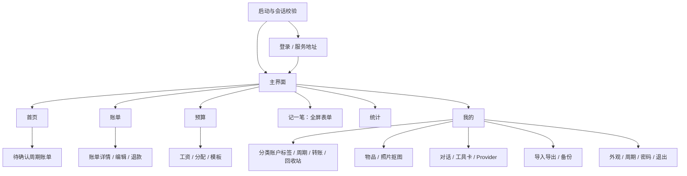

# Android 全界面 UI 重构与动效规划

版本：规划 v1.0 · 日期：2026-10-10 · 关联任务：`10-10-android-ui-redesign`。

当前实际功能及源码发现的缺口以 [Android 功能 README](../README.md) 为维护入口。本文件记录设计意图；后续调整设计需对照功能 ID，不能用规划内容代替已实现证据。

**这是 UI 重构的设计与实施基线，实施已于 2026-10-10 启动。** 页面结构、尺寸和动效参数是逐模块实现与设备验收的基准；视觉细节会随集成审查调整。现有功能以 Kotlin 源码及 Repository 为基线，页面存在、APK 能编译、真机验收通过是不同阶段；当前首批模块已编译打包，S01–S48 全量设备验收仍在进行。

## 阅读导航

- [目标与边界](#1-目标与边界)
- [功能证据与覆盖矩阵](#2-功能证据与覆盖矩阵)
- [整体导航和用户路径](#3-整体导航和用户路径)
- [视觉与组件系统](#4-视觉与组件系统)
- [全部页面设计 S01–S48](#5-全部页面设计)
- [动画十二原则与动效参数](#6-动画十二原则与动效参数)
- [数据、交互与技术边界](#7-数据交互与技术边界)
- [分阶段实施计划](#8-分阶段实施计划)
- [验收与交付要求](#9-验收与交付要求)
- [参考与待实测项](#10-参考与待实测项)

## 1. 目标与边界

让用户在手机上顺畅完成“查看账本 → 记账 → 核对预算”，并能完整操作工资、周期账单、统计、主数据、转账、回收站、导入导出、AI 和物品资产。设计按功能组织，重要信息先出现，危险操作清晰表达，动画帮助理解状态变化。

### 1.1 必须保留的合同

- Kotlin + Jetpack Compose 原生 Android；现有最低版本 Android 8 / API 26。鸿蒙 4 的 APK 安装、返回手势、文件选择器和动画需要实际设备验证。
- 默认服务为 `https://jz.yansuu1.xyz`，保留自定义服务地址、原账号登录、会话恢复、过期回登录、退出登录与改密。
- 金额以整数分传输，UI 负责格式化；预算、余额、日均成本和统计以服务器结果为准。
- 退款是带退款标记的收入，可关联原支出。不要沿用旧 Web 规范中“退款负支出、不算收入”的过时文字。
- 保留三种主题偏好：跟随系统、浅色、深色；保留钛蓝、森林绿、极简黑白三种配色与分类颜色。
- 不要求 Google 服务；文件使用 Android 系统文档接口，照片与抠图沿用现有私有后端。
- 生产域名继续只提供 API，不恢复网站。Web 源码暂作核对参考，删除门槛由原交付任务管理。

### 1.2 本方案允许的调整

将混在一起的列表、编辑表单和设置拆为独立页面；统一日期、分类、账户、标签选择；为账单增加利用现有详情接口的只读详情页；优化“我的”分组；增加草稿返回确认、危险操作确认、列表位置恢复和明确错误提示。它们均是现有能力的交互整理，不改变账务规则。

### 1.3 不纳入本次重构

多用户共享账本、离线记账与自动同步、汇率/多币种、指纹/PIN 锁、推送提醒、自动后台入账、新的 AI 工具、新备份恢复 API、云图片编辑器、鸿蒙 5/6 原生端、后端账务重写、服务器再次迁移。新的业务能力应另立任务。

### 1.4 方案取舍

| 方案 | 收益 | 代价 | 本方案选择 |
|---|---|---|---|
| 仅换颜色和圆角 | 改动小 | 长表单、按钮密集和导航返回问题仍在 | 不采用 |
| 保留功能，重组页面并统一组件 | 可追溯功能，逐模块交付 | 需要建立统一页面状态与导航 | 采用 |
| 全新信息架构并重写数据层 | 自由度高 | 容易改变口径，联调与迁移成本高 | 不采用 |

## 2. 功能证据与覆盖矩阵

以下路径均相对 `clients/android/app/src/main/java/com/yansuu1/jizhang/`。这是 2026-10-10 的源码核对结果，不代表对应功能均已获得生产真机验收。

| 功能域 | 现有源码证据 | 保留的能力 | 新设计页面 |
|---|---|---|---|
| 启动、会话、登录 | `MainActivity.kt`、`ui/LoginScreen.kt`、`repo/AuthRepository.kt`、`net/ApiClient.kt` | 地址、登录、恢复、401、退出、改密 | S01–S03、S48 |
| 应用壳、我的 | `ui/MainShell.kt`、`ui/MyTab.kt` | 六入口及所有二级功能 | S04、S23 |
| 首页 | `ui/DashboardTab.kt` | 总余额、月收支、预算摘要、待确认、最近账单 | S04 |
| 账单 | `ui/TransactionsTab.kt`、`ui/TransactionEditSheet.kt`、`ui/LedgerLinkPicker.kt`、`repo/LedgerRepository.kt` | 搜索、月/type/分类/账户/标签筛选、分页、CRUD、表达式金额、退款关联 | S05–S10 |
| 预算与工资 | `ui/BudgetTab.kt`、`ui/SalarySheet.kt`、`repo/BudgetRepository.kt` | 历史周期、结转、模块预算、工资 CRUD、到账账户、模板、手动分配 | S11–S16 |
| 分配模板 | `ui/ManageTab.kt` 中 `TemplatesTab` | CRUD、默认模板、应用本周期、百分比分配 | S17–S18 |
| 周期账单 | `ui/RecurringRulesTab.kt`、`ui/PendingTab.kt` | 规则 CRUD、启停、五种频率、锚点、生成、确认、忽略 | S19–S21 |
| 统计 | `ui/StatsTab.kt`、`ui/Charts.kt`、`repo/BudgetRepository.kt` 中 `StatsRepository` | 指定月、快捷区间、分类占比、3/6/12 月趋势、结转趋势 | S22 |
| 分类、账户、标签 | `ui/ManageTab.kt`、`repo/AdminRepository.kt`、`repo/LedgerRepository.kt` 中 `MetaRepository` | 层级/图标/色板、账户类型/初始余额、排序、删除影响、标签改名删除 | S24–S28 |
| 转账、回收站 | `ui/TransfersTrashTabs.kt`、`repo/LedgerRepository.kt` | 转账 CRUD/分页、账单单项/全部恢复与彻底删除 | S29–S31 |
| 数据与备份 | `ui/DataTab.kt`、`ui/DocumentFiles.kt`、`repo/PortabilityRepository.kt` | 四种 CSV 导出、账单/转账 CSV 导入、微信 xlsx/支付宝 GBK CSV、预览与选行、备份列表/创建 | S32–S36 |
| 物品、照片、抠图 | `ui/ItemsTab.kt`、`repo/ItemRepository.kt`、`repo/ItemPhotoUploader.kt` | 搜索/分页、CRUD、生命周期/售出、账单关联、照片、候选生成/预览/使用/取消 | S37–S41 |
| AI 助理 | `ui/AssistantTab.kt`、`repo/AssistantRepository.kt` | 对话列表/新建/归档、消息/附件、工具卡确认取消、导入选行与分类修正 | S42–S44 |
| AI 配置 | `ui/ProviderSettings.kt` | 三模式、HTTP 方法、认证、密钥语义、自定义模板、测试 | S45 |
| 设置与外观 | `ui/ItemsTab.kt` 中 `SettingsFull`、`ui/ThemePrefs.kt`、`ui/theme/JizhangTheme.kt` | 三主题/三配色、周期起算日、改密、退出 | S46–S48、S23 |

核对方式：每一行均须在后续实现验收表中保留。不得因视觉简化删除自定义 Provider 字段、标签、退款关联、历史工资分配或文件预览。

## 3. 整体导航和用户路径

### 3.1 应用壳

保留当前六个底部入口顺序：**首页 / 账单 / 预算 / 记一笔 / 统计 / 我的**。其中“记一笔”是即时动作，不建立空白 Tab，也不丢失进入前的位置。使用独立的钱包/预算图标区分预算与加号。

- 首页、账单、预算、统计、我的为五个可恢复状态的主页面；各自保存滚动位置和已应用筛选。
- 记一笔打开全屏编辑页，隐藏底部栏；取消回到来源页，保存成功回到来源页并刷新相关数据。
- 工资、分类管理等二级页隐藏底部栏，顶部显示标准返回按钮和页面标题。
- 手机保留六入口可见标签；大字体下可增高底栏和允许标签换行，不截断“记一笔”。横屏/宽屏可将五主页面放入侧边导航，记一笔为独立按钮。
- 不增加悬浮按钮遮挡内容，不重复放两个同权重的记账入口；页面内快捷入口可以保留为次级动作。



### 3.2 核心操作路径

| 用户目的 | 路径 | 完成后的反馈 |
|---|---|---|
| 记一笔支出 | 任意主页面 → 记一笔 → 金额/分类/账户 → 保存 | 保存成功，返回来源，预算/账单/余额失效并重取 |
| 收到退款 | 原账单详情 → 记录退款 → 收入表单并保留关联 → 保存 | 退款收入与原支出关联可见；原支出不被改写 |
| 发工资 | 预算 → 工资记录 → 新建 → 到账账户/模板 → 保存 | 工资列表及本周期预算刷新 |
| 确认周期账单 | 首页提示或我的 → 待确认 → 核对 → 确认 | 该项确认成功后移出待办，账单与预算刷新 |
| 导入平台账单 | 我的 → 数据管理 → 平台账单 → 文件 → 预览选行 → 确认 | 返回实际新增/跳过/失败结果，不假定全部写入 |
| 管理物品照片 | 我的 → 物品 → 详情 → 照片与抠图 → 候选 → 使用 | 仅使用成功后替换照片；放弃候选保留原照 |
| AI 辅助记账 | 我的 → AI 助理 → 对话 → 行动卡 → 核对并确认 | 卡片变为服务端终态，账本按实际执行结果刷新 |

### 3.3 返回顺序

系统返回与顶部返回执行同一逻辑：先关闭键盘/选择器，再关闭最上层弹层，再返回二级页来源，最后由系统处理主界面的退出。编辑页有修改时显示“继续编辑 / 放弃修改”；未修改直接返回。网络写入中保持结果可追踪，不靠动画结束来触发写入或成功跳转。

## 4. 视觉与组件系统

### 4.1 视觉方向

采用安静、清晰的原生财务工具风格：暖灰背景、实色卡片、钛蓝重点、规整金额对齐。首页保留深色余额主卡；其它页面以普通浅/深表面为主，避免每页都堆大卡片。现有三种配色保留，重点重构层级、留白和信息密度。

| 元素 | 设计目标 |
|---|---|
| 页面背景 / 卡片 | 沿用 `JizhangTheme.kt` 语义色；钛蓝浅色 `#F7F5F0 / #FFFFFF`、深色 `#131C22 / #1E2127` |
| 重点色 | 钛蓝浅色 `#2F6F8F`、深色 `#7FB6D3`；按钮文字使用对应 `onAccent` |
| 语义色 | 支出/危险、收入/正常、警告各有图标与文字；不能只靠红绿判断 |
| 字号 | 金额主标题 32sp，页面标题 24sp，区块标题 18sp，正文 16sp，辅助 14sp；不锁定系统字号 |
| 间距 | 4/8/12/16/24/32dp；手机横向留白 16dp；表单宽屏最大 640dp |
| 圆角 | 卡片 18dp、输入/按钮 12dp、底部选择面板顶部 24dp；只用于适合的组件 |
| 高度 | 顶栏目标 56dp；普通行至少 64dp；点击热区至少 48×48dp；主按钮至少 48dp |
| 边界 | 分组优先用间距/标题；弱分隔线不承担唯一边界；金额列留足千分位及负号空间 |
| 阴影 | 普通卡片依靠表面/边框；浮层使用一档提升，关键确认浮层一档更高提升；深色重视表面差异 |

上述颜色是现有源码基线，不声称所有组合已测量达标。实施阶段对正文/按钮/辅助文案逐对计算对比度：普通文字目标 ≥4.5:1，大文字与关键图形目标 ≥3:1；分类色不直接用作小字号文字。

### 4.2 组件清单

| 组件 | 必须支持的状态和行为 |
|---|---|
| `AppPage` / `AppTopBar` | 主/二级页面、返回、单一主操作、系统栏/IME Insets、长标题 |
| `MoneyText` / `MoneyField` | 精确分格式化、负数、未知值“—”、大额、表达式预览、无金额滚动动画 |
| `LedgerRow` / `AccountRow` / `ItemRow` | 主文字/副文字/金额、状态标记、明确菜单、稳定 ID |
| `SectionCard` / `MetricCard` | 内容展开、标题/说明、错误和空值；无需每条列表套卡 |
| `SelectorField` / `SelectionSheet` | 单选/多选、搜索、清除、当前值、已删除关联对象只读回显 |
| `FilterBar` / `FilterSheet` | 草稿筛选/应用筛选分离，已选条件数，清除，仅应用后请求 |
| `FormScaffold` / `SaveBar` | 滚动表单、底部保存随 IME 上移、字段错误、未保存离开确认、写入防重复 |
| `InlineError` / `StatePanel` | 首次加载/空数据/加载失败/刷新失败/无权限/离线的不同文案 |
| `ConfirmDialog` | 对象、影响、可恢复性、取消、明确动词，失败保留上下文 |
| `ResultCard` / `ActionCard` | 服务端执行状态、成功/失败/部分成功、不可重复执行终态 |
| `ChartFrame` | 图形/图例/文字明细，区间标签，负值、零值、单点、无数据 |
| `PhotoFrame` | 加载/损坏/无照片、比例固定、原图/候选、透明棋盘格 |

### 4.3 全局页面状态 G

S01–S48 均继承适合自身的全局状态，下面逐页再说明特殊状态。

- **首次加载**：保留标题与导航，显示静态占位块或明确进度；不显示虚假的零余额。超过 300ms 的等待再展示加载提示，避免短请求闪烁。
- **刷新**：保留旧数据与筛选，轻量显示“更新中”；失败提示“更新失败，当前显示上次结果”，不冒充最新。
- **空数据**：区别“尚未记录”与“筛选无结果”；分别提供新建和清除筛选。
- **错误**：可重试，并保留输入；403 展示权限限制，401 统一回登录，网络错误说明服务暂不可达。
- **写入**：按钮立即变“保存中”，同一动作只能有一个请求；网络超时提示结果待核对，先重取确认，不盲目重发导致双重记账。
- **成功**：服务端确认后刷新关联页面；轻提示与可见结果共同证明成功。
- **离线**：允许查看当前内存中的结果并标记未更新；不提供未经设计的离线写入队列。
- **销毁/恢复**：普通草稿与滚动位置可恢复；密码、API 密钥、附件字节不进入可持久化状态；原文件丢失时要求重新选择。

## 5. 全部页面设计

这里的“页面”包括全屏页、选择面板及具有独立流程的功能视图，共 48 个设计单元。每个单元均写明入口、布局、操作、异常和动效；G 是 §4.3 的全局状态，M 是 §6.2 的统一动效。

### 5.1 启动与登录

#### S01 启动与会话校验

- **入口/返回**：冷启动、进程恢复；校验后进入登录或上次主页面，不接受缓存用户名作为登录证据。
- **布局**：系统启动画面之后，居中应用名与“正在连接服务”；下方只在超时后出现重试与服务地址入口。
- **操作**：读取地址/主题 → 有有效 Cookie 才请求当前用户 → 成功进主界面；失败区分会话过期与网络不可达。
- **状态**：G；没有 Cookie 直接登录；超时不自动清空有效 Cookie，也不进入已认证界面。
- **动效/验收**：M02 短淡入，不增加品牌等待；深色冷启动不闪浅色，断网可去修改地址。

#### S02 登录

- **入口/返回**：S01、会话过期、主动退出；系统返回由系统处理。
- **布局**：应用名/欢迎文案 → 当前服务简写与“修改” → 用户名 → 密码与显隐 → 登录主按钮 → 状态提示；键盘弹出后表单可滚动。
- **操作**：IME 下一项/完成；登录中阻止重复提交；原账号登录成功进入首页。
- **状态**：错误密码贴近表单，网络错误附地址入口；过期说明“登录已过期，请重新登录”；保留用户名，不恢复密码。
- **动效/验收**：M01、M08；错误先文字再可选短位移反馈；大字号/键盘下登录按钮始终可达。

#### S03 服务地址设置

- **入口/返回**：登录页“修改服务”、设置中的服务信息；保存后回登录。
- **布局**：标题 → 地址输入 → 当前目标说明 → “恢复默认地址”次操作 → 保存主按钮；默认值显示完整域名。
- **操作**：校验现有 URL 合同，格式错误不请求；切换实际服务后清理旧服务身份，要求重新登录。
- **状态**：未改直接返回；更换服务前告知需重新登录；无法连接可保留原值并再次编辑。
- **动效/验收**：M03、M09；不会把旧域名 Cookie/密码发往新地址，重开 App 保留已保存地址。

### 5.2 首页与账单

#### S04 首页

- **入口/返回**：首页主入口；保持滚动位置。
- **布局**：月标签/刷新 → 深色总余额主卡 → 服务端返回的收入/净支出摘要 → 服务端结转池与各预算模块的剩余/进度 → 待确认提醒 → 最近账单/查看全部。没有服务端返回的月结余/总剩余金额时不展示客户端相减得到的新金额；无提醒不留空卡。
- **操作**：查看全部到账单；待确认到 S21；预算卡到 S11；快捷记账到 S08；最新账单可到 S07。
- **状态**：G；各区块独立失败时其它区块可用；无工资显示预算建立指引；负结转和模块剩余按原值展示。
- **动效/验收**：M02 只对首次可见区块，M06 进度；金额立即显示最终值，回切首页不反复从零播放。

#### S05 账单列表

- **入口/返回**：账单主入口、首页查看全部；返回保留月/筛选/位置。
- **布局**：标题/搜索 → 月选择与前后切换 → 全部/支出/收入 → 筛选条件 Chips → 按原接口顺序展示账单 → 分页区。只在当前页有足够明细时做日期分组，不合成未提供的整日总额。
- **操作**：行点击详情，更多菜单编辑/删除；搜索确认后查询；保留显式上一页/下一页，不先替换成无限列表。
- **状态**：G；改变筛选回第一页；已删除分类/账户仍显示历史名称；删账单确认“可在回收站恢复”。
- **动效/验收**：M04 行增删、M05 选中反馈；翻页仅内容短淡入，长列表无逐行排队。

#### S06 账单筛选面板

- **入口/返回**：S05 筛选；应用/取消回 S05。
- **布局**：账户、分类（父/子）、标签三个区域；顶部当前条件数，底部“重置 / 应用筛选”。搜索词和月份仍由列表主控件负责。
- **操作**：面板内改变仅修改筛选草稿，应用才查询；重置可预览清空；取消不改变原筛选。
- **状态**：候选加载失败可重试；当前历史选项缺失显示其原名称并可清除，不偷偷换成全部。
- **动效/验收**：M03、M05；所有选项可滚动，应用后列表、条件标签和接口查询一致。

#### S07 账单详情

- **入口/返回**：S04/S05/S09；返回原位置。
- **布局**：类型/金额 → 分类/账户/时间 → 备注/标签 → 退款标记与关联账单 → 编辑主操作、删除次操作；工资记录若需跳工资页，明确指向 S14。
- **操作**：编辑到 S08；支出可“记录退款”到 S10；查看关联账单按已有 ID 请求详情。
- **状态**：G；记录已删除显示不可用并返回列表；关联目标失效显示“关联记录已不可用”而不清掉关系。
- **动效/验收**：M02、M09；详情使用现有 getTransaction，无新账务字段或本地重新计算退款余额。

#### S08 新建/编辑账单

- **入口/返回**：记一笔、详情编辑；保存/取消回来源。
- **布局**：类型分段 → 大金额输入/表达式结果 → 分类 → 账户 → 日期 → 备注/标签 → 收入退款入口；底部固定保存栏。
- **操作**：金额保留当前表达式能力和精确分转换，非法表达式提示而不自动截断；分类仅展示当前类型可用项；日期用选择器与可编辑文本兜底。
- **状态**：G；缺分类/账户提供去管理入口并可返回草稿；编辑须完整加载后可保存；未知历史字段不可因 UI 不展示而丢失。
- **动效/验收**：M03 表单进入、M01 保存、M08 错误；返回/旋转保留普通草稿，键盘不遮金额与保存。

#### S09 通用选择面板

- **入口/返回**：账单、工资、规则、物品关联、转账等表单；选择后回原字段。
- **布局**：标题/搜索/当前值 → 可滚动候选 → 多选确认；分类有父子缩进、账户有类型和可得余额、标签为可选 Chips，日期采用系统风格日历。账单关联有类型/日期/金额/备注与分页。
- **操作**：单选即时确定；多选显式确认；关联账单支持“不关联”；标签允许表单输入并复用现有提交合同，不新增标签创建 API。
- **状态**：G；关联列表沿用 50 条分页；历史选项只读回显；候选加载失败不影响已经选中的值。
- **动效/验收**：M03、M05；分类树不只靠颜色表示层级；读屏能读出选中状态、类型与金额。

#### S10 退款关联流程

- **入口/返回**：原支出 S07 或收入 S08；完成回收入表单。
- **布局**：退款说明 → 原支出卡/“选择关联支出” → 多选账单列表 → 返回收入表单；收入表单金额仍是退款金额。
- **操作**：使用 `isRefund`、`refundLinkedTxIds`；从原支出进入可预选该支出；取消保留原草稿。
- **状态**：不关联也按现有后端规则处理；编辑退款须恢复全部关联，目标失效显示原关联信息并允许用户明确移除。
- **动效/验收**：M05 关联选择；原支出与退款收入保持两个独立记录，不把支出改小、不把收入隐藏。

### 5.3 预算、工资与模板

#### S11 预算总览

- **入口/返回**：预算主入口、首页预算卡。
- **布局**：周期标题/历史选择 → 总预算/已用/剩余 → 结转池 → 待确认提示 → 分类模块卡 → 工资记录、分配模板两个明确入口。
- **操作**：周期到 S12；模块到 S13；工资到 S14；无预算引导记工资。
- **状态**：G；零预算/超支/负结转都有文字标签；历史周期醒目显示“历史”，不把当前工资操作暗示为修改历史预算。
- **动效/验收**：M06 进度有上限但数值不裁剪；超支标签仍显示真实超支，切周期只重绘当前模块。

#### S12 预算周期选择

- **入口/返回**：S11 周期标题；选中后回 S11。
- **布局**：当前周期置顶，历史周期按服务端返回排序，日期范围明确，当前/选中标记。
- **操作**：选择服务端提供的 `periodStart`，不可自行生成假历史周期；返回不改变当前选择。
- **状态**：无历史时只显示当前可用项；加载失败保留已选周期。
- **动效/验收**：M03、M05；不把自然月筛选误当预算周期，起算日不同仍用后端周期。

#### S13 预算模块展开视图

- **入口/返回**：S11 模块；手机用独立详情视图或可展开卡，返回原模块位置。
- **布局**：模块名 → 后端预算/已用/剩余 → 进度与“超支/未分配”状态 → overview 实际返回的子项；不出现接口未提供的“每日可花”等推算。
- **操作**：仅当账单筛选能准确表达同一分类范围时提供“查看账单”，并显示范围；父模块的子分类聚合查询不受支持时不提供虚假的完整明细入口。
- **状态**：G；overview 缺子项就展示当前模块数据；模块删除或周期变化后重新取数。
- **动效/验收**：M06、M10 小范围展开；展开不遮挡剩余金额，所有数字与同周期 overview 一致。

#### S14 工资记录列表

- **入口/返回**：预算、我的；返回来源。
- **布局**：标题/新建 → 历史工资行（金额、日期、到账账户、备注） → 行菜单编辑/分配/删除；不把新建表单固定在历史列表上方。
- **操作**：S15 新建/编辑、S16 分配；删除明确影响现有工资和预算，确认后刷新。
- **状态**：G；列表沿用现有接口能力，不假设新增服务器分页；无记录引导“记录第一笔工资”。
- **动效/验收**：M02、M04；编辑与分配不会串到其它工资 ID，删除后预算/余额刷新。

#### S15 新建/编辑工资

- **入口/返回**：S14；回工资列表。
- **布局**：金额 → 到账日期 → 到账账户 → 分配模板（新建时） → 备注 → 保存；模板旁显示默认状态及查看入口。
- **操作**：沿用 createSalary/updateSalary 的不同字段合同；编辑不暗中重选模板，不未经确认覆盖既有分配。
- **状态**：G；无模板指引 S17；账户为空、日期错误就地提示；工资保存与分配更新分别体现服务端结果。
- **动效/验收**：M03、M01；工资到账金额与账户实际变化一致，不能产生一笔额外普通收入来代替工资。

#### S16 工资分配编辑

- **入口/返回**：S14 某条工资“分配”；回对应工资列表。
- **布局**：工资日期/总金额 → 模块金额列表 → 输入合计/与工资金额差额的校验提示 → “替换分配”主按钮。
- **操作**：只编辑该工资的 allocation；输入合计是表单校验辅助，不充当预算余额；写入前明确“替换这笔工资的现有分配”。
- **状态**：G；载入失败不能显示空表当作真实零分配；保存失败保留输入；父模块与子项冲突按服务端规则提示。
- **动效/验收**：M05 字段焦点、M09 确认；分配成功后重新加载工资详情和预算，不根据输入值直接拼出预算。

#### S17 分配模板列表

- **入口/返回**：预算、我的；回来源。
- **布局**：标题/新建 → 模板名/默认标记 → 模块比例摘要 → 更多菜单：编辑、设默认、应用本周期、删除。
- **操作**：编辑 S18；设默认显示实际结果；应用本周期确认会覆盖本周期工资分配；删除说明历史分配保留。
- **状态**：G；没有模板提供新建；应用失败保留现状；默认模板菜单明确不能再次设默认。
- **动效/验收**：M05 默认标记、M09 覆盖确认；改变默认不等于自动修改历史工资。

#### S18 新建/编辑模板

- **入口/返回**：S17；回列表。
- **布局**：名称 → 分配模块选择 → 每个选中模块比例输入 → 合计与剩余比例提示 → 保存；不用几十个空输入占满屏幕。
- **操作**：比例合计 100%，单项为合法正比例，父模块及其子分类不能同时分配；使用现有 `categoryId/ratio` 合同。
- **状态**：G；本地校验减少错误请求，服务端为最终判定；用户已移除的模块明确展示，不静默丢弃。
- **动效/验收**：M04 模块增删、M08 错误；100% 提示为稳定文字，不用环形转动吸引注意。

### 5.4 周期账单与统计

#### S19 周期账单规则列表

- **入口/返回**：我的账本管理；回我的。
- **布局**：标题/新建 → 规则名、金额、分类/账户、频率/起始日期 → 启用状态与更多菜单 → 待确认入口。
- **操作**：S20 编辑，启停、删除；启停以服务器确认结果更新，不动画先表示成功。
- **状态**：G；关闭规则不暗示删除历史发生记录；删除说明针对规则，影响以实际 API 为准。
- **动效/验收**：M05 开关、M09 删除；支持每天、每周、每月、每季、每年，不缩减为月账单。

#### S20 周期规则编辑

- **入口/返回**：S19；回规则列表。
- **布局**：名称 → 收入/支出 → 金额 → 分类/账户 → 频率五选一 → 锚点起始日期 → 备注 → 保存。
- **操作**：类型变化更新可选分类，保留频率与锚点语义；日期选择器替代纯手写，并保留明确日期回显。
- **状态**：G；缺主数据可进入管理后返回草稿；无效锚点不自动纠正成今天。
- **动效/验收**：M03、M05；不自行推算/承诺下一发生日，只有已有接口提供时才显示。

#### S21 待确认周期账单

- **入口/返回**：首页、预算提示、我的；回来源。
- **布局**：待确认总数 → 规则名/日期/金额/分类/账户 → 每项“确认入账 / 忽略”；顶部刷新。
- **操作**：沿用 generate 后 pending 的现有刷新流程；逐项确认/忽略，不新增没有合同的批量确认。
- **状态**：G；单行请求锁定该行；服务器已处理项重新获取后移除；生成失败与加载失败可区分。
- **动效/验收**：M04 处理成功后收起；失败行留在原处，未获服务端成功不从列表消失。

#### S22 统计

- **入口/返回**：统计主入口。
- **布局**：分类统计区间（本月/近30天/近3个月/指定月） → 分类占比图与明细 → 收支月趋势独立 3/6/12 月选择 → 结转趋势与明细。各图区间标题独立显示。
- **操作**：选择指定月份用年月选择器；点图形显示对应值；图表提供“图表/明细”切换；只在接口能保持同一范围时才提供账单跳转。
- **状态**：G；全零、单点、负结转、无数据各有准确画法；区间含义沿用当前接口，不把现有“近30天”算法擅自改为新的滚动窗口。
- **动效/验收**：M07 圆弧/柱形、M06 线条短揭示；数字与图例一直可读，读屏可读取文本明细而非只能看图。

### 5.5 我的、分类、账户与转账

#### S23 我的功能中心

- **入口/返回**：我的主入口。
- **布局**：账号/服务域名 → “账本管理”（工资、分类、账户、标签、模板、周期、转账） → “智能与物品”（AI、AI配置、物品） → “数据与维护”（数据、回收站） → “偏好与账户”（外观、周期起点、密码、服务地址） → 底部退出登录。
- **操作**：整行可点且有图标、说明、箭头；常用项可在功能组顶部排序，但不增加不可保存的自定义排序能力。
- **状态**：用户名只来自有效会话；AI 未启用显示状态而不隐藏入口；退出确认后执行原 logout。
- **动效/验收**：M02 仅前三个可见分组；每个当前 MyTab 入口均有可见对应位置，退出不误触。

#### S24 分类管理

- **入口/返回**：S23 账本管理；回我的。
- **布局**：支出/收入 → 父模块/子分类缩进列表 → 图标/名称/内建标记 → 新建 → 行更多菜单编辑/上移/下移/删除。
- **操作**：S25 编辑；排序沿用 moveCategory；删除前查询 usage，显示被引用账单数，说明历史记录保留。
- **状态**：G；内建/不可改字段按现有规则限制；顺序提交失败保留真实原顺序。
- **动效/验收**：M04 成功后位移；提供上移/下移文字按钮，不能只提供拖拽；收入分类不引入不支持的父模块。

#### S25 分类编辑

- **入口/返回**：S24；回列表。
- **布局**：名称 → 类型（新建） → 父模块（支出） → 图标网格 → 十二色选择/原色预览 → 保存。
- **操作**：编辑不改变既有类型；排除自身作为父级；保留非标准原色，图标仍用现有允许值。
- **状态**：G；非法父子关系按服务端提示处理；颜色无需普通用户手写 ARGB。
- **动效/验收**：M05 图标/色块选中；色块有选中勾和色名，已有自定义颜色不会因重构被替换。

#### S26 账户管理

- **入口/返回**：S23；回我的。
- **布局**：账户列表显示名称/类型/当前余额/初始余额；新建、编辑、上移、下移、删除置于明确菜单。
- **操作**：S27 编辑；删除前请求引用数量，说明从总余额移除但历史账单保留；余额只能来自 balances。
- **状态**：G；负余额显示负号与“负余额”，缺余额显示“—”；账户已删除不影响历史名称回显。
- **动效/验收**：M04 排序、M09 删除；不能把初始余额输入值当作当前余额。

#### S27 账户编辑

- **入口/返回**：S26；回列表。
- **布局**：名称 → 类型（现金/储蓄卡/信用卡/支付宝/微信/其他） → 初始余额 → 影响说明 → 保存。
- **操作**：初始余额支持负值与两位小数，超出安全整数范围提示；编辑初始余额明确会影响后端余额计算。
- **状态**：G；不把“-10.00”转换为支出账单；不使用浮点金额四舍五入吞掉第三位小数。
- **动效/验收**：M01、M08；中英数字输入/负值/大额测试通过，旧账户 ID 不变。

#### S28 标签管理

- **入口/返回**：S23；回我的。
- **布局**：标签名/引用账单数 → 改名/删除；改名小表单、删除影响确认。
- **操作**：复用 renameTag/removeTag；新增标签仍在账单表单输入，不增加空标签数据库操作。
- **状态**：G；改名冲突返回明确服务端提示；删除说明从相关账单移除这个标签，不删除账单。
- **动效/验收**：M04 行更新；同名中文标签、含空格的名称不因 UI 自动加工造成错误。

#### S29 转账列表

- **入口/返回**：S23；回我的。
- **布局**：标题/新建 → 转出账户 → 转入账户、金额、日期、备注 → 更多菜单 → 显式分页。
- **操作**：S30 编辑/新建；删除前明确“转账不进入回收站”；成功后余额相关页刷新。
- **状态**：G；不可把转账当支出收入，删除失败保留原行。
- **动效/验收**：M04、M09；第 51 条可通过分页到达，账户双向信息清晰。

#### S30 转账编辑

- **入口/返回**：S29；回列表。
- **布局**：转出账户 → 箭头/交换按钮 → 转入账户 → 金额 → 日期 → 备注 → 保存。
- **操作**：选择账户，交换只交换表单值；不自动提交；同账户和非法金额就地提示并服从服务端约束。
- **状态**：G；保存失败保留完整方向与金额；历史账户缺失明确回显。
- **动效/验收**：M05 选择；交换用短淡变，不让两个金额对象满屏飞行。

#### S31 回收站

- **入口/返回**：S23；回我的。
- **布局**：说明“这里只管理已删除账单” → 记录列表/恢复/彻底删除 → 全部恢复、彻底清空；危险批量动作与单条操作分开。
- **操作**：每次彻底删除必须确认对象与不可恢复；清空确认说明作用于全部回收站记录，不仅当前返回列表。
- **状态**：G；当前接口返回条数受限且没有完整分页能力，显示“以下为接口返回的记录”，不承诺展示全部；空返回也不推断后台必然没有更多记录。
- **动效/验收**：M04 成功后移除、M09 危险确认；不能直接点击一次就清空；转账/物品不伪装成可恢复。

### 5.6 数据管理

#### S32 数据管理中心

- **入口/返回**：S23 数据与维护；回我的。
- **布局**：四个功能区：导出文件、导入本应用 CSV、导入微信/支付宝账单、数据库备份。每区说明用途与数据类型。
- **操作**：分别进入 S33–S36；“恢复备份”仅为操作说明，不做不存在的上传恢复按钮。
- **状态**：G；长任务结果返回后保留，不能仅闪一条 Toast。
- **动效/验收**：M02 分组进入；用户能区分平台 CSV 与本应用 CSV，避免选错导入器。

#### S33 CSV 导出

- **入口/返回**：S32；回中心。
- **布局**：账单/工资/周期规则/转账四种类型 → “选择保存位置并导出” → 导出状态/文件名/结果说明。
- **操作**：Android CreateDocument 选择保存位置，沿用后端文件，不由页面重新拼账本 CSV。
- **状态**：取消位置选择是正常返回；文件写入失败保留重试；服务端下载失败不提示导出完成。
- **动效/验收**：M01 按钮状态、M11 结果；四类都可选，中文、日期、退款字段与服务端输出一致。

#### S34 本应用 CSV 导入

- **入口/返回**：S32；回中心。
- **布局**：账单/转账类型 → 文件选择 → 文件名与校验结果 → 重复 ID 跳过说明 → 导入 → 新增/跳过/读取结果。
- **操作**：保留宽 MIME 文档选择兼容，实际校验 `.csv`、非空、≤10MiB；类型明确后才能导入，不为工资/规则宣称已有导入能力。
- **状态**：无效新文件要清除旧文件选择，避免导入旧内容；取消无副作用；导入结果用服务端计数，后续刷新关联页面。
- **动效/验收**：M11 结果，不用假百分比；导出账单再导入应验证重复跳过，文件选择器不能把自己的导出文件置灰。

#### S35 微信/支付宝账单导入

- **入口/返回**：S32 或 AI 导入卡；直接入口按本页流程，AI 入口共享预览组件但保留自身 action 合同。
- **布局**：选择文件 → 识别来源/预览摘要 → 每行日期/对象/金额/类型/分类/状态 → 分类修正/选行 → 固定底栏“确认导入所选 N 条” → 实际结果。
- **操作**：微信 xlsx、支付宝 GBK CSV；服务端 dry-run 预览；被忽略/可能重复行明确标记；沿用已有默认选中规则；全选只能选当前允许导入的候选。
- **状态**：损坏/编码/不支持文件分别提示；更换文件清空旧 preview/selection/override；确认使用对应原文件，不把预览数据伪造成源文件。
- **动效/验收**：M05 选行、M11 结果；连续选择两个文件不串行 ID，部分成功不显示“全部成功”。

#### S36 数据库备份

- **入口/返回**：S32；回中心。
- **布局**：说明备份存在服务器 → “创建备份” → 文件名/大小/创建时间列表 → 恢复说明。没有下载接口时不画可点击下载。
- **操作**：沿用 createBackup/listBackups；创建结束重新请求列表；恢复提示通过服务器 CLI 操作，并说明先另行备份。
- **状态**：G；备份创建失败不插入虚假文件；无记录提供创建入口。
- **动效/验收**：M04 新备份行、M11 成功；仅承诺现有 API 的创建和查看能力，客户端不得覆盖服务器数据库。

### 5.7 物品资产与照片

#### S37 物品列表

- **入口/返回**：S23 智能与物品；回我的。
- **布局**：在册购入总额/当前日均成本 → 搜索 → 物品行（缩略图、名称、状态、购入价、日均、持有时间） → 分页 → 新建入口。
- **操作**：搜索按当前 list 合同，S38 详情、S39 新建；不增加 API 未支持的高级排序或统计。
- **状态**：G；缺购入价显示“未填写”而不是 0；无照片使用静态图标；第 51 件可访问。
- **动效/验收**：M02、M04；滚动图片不反复入场，不一次解码全尺寸照片。

#### S38 物品详情

- **入口/返回**：S37；回原列表位置。
- **布局**：固定比例照片 → 名称/状态 → 购入价/日均/持有天数 → 日期/品牌/型号/分类/备注 → 购入/售出账单关联 → 编辑、照片与抠图 → 生命周期操作。
- **操作**：S39 编辑、S40 售出/结束持有、S41 照片；删除有独立不可恢复提示，以现有接口为准。
- **状态**：G；售出/结束状态按后端显示可用动作；服务器给出的日均为准，缺价格不拼假的成本。
- **动效/验收**：M02 照片淡入；不拉伸物品照片，旋转/返回不会重复提交售出。

#### S39 新建/编辑物品

- **入口/返回**：S37/S38；回来源。
- **布局**：名称/购入日期/购入价 → 购入账单关联 → 品牌/型号/物品分类/备注折叠区 → 编辑时已有状态回显 → 保存。
- **操作**：购入价可空，不混同零；物品分类沿用当前自由文本，与账单分类区别标注；状态字段仅保留现有支持值，售出走 S40。
- **状态**：G；关联支出通过 S09；未加载完成不覆盖原字段，编辑不能丢购买关联。
- **动效/验收**：M10 次要字段展开、M01 保存；照片留在独立流程，编辑失败不会删原照片。

#### S40 售出/结束持有/删除物品

- **入口/返回**：S38；取消回详情，完成刷新详情/列表。
- **布局**：对象摘要 → 操作类型 → 结束日期；售出增加售价与收入账单关联；删除单独危险确认，不混在同一个默认表单。
- **操作**：sell、retire、remove 分别调用；售出仅关联收入，不自动创造未被接口要求的收入账单。
- **状态**：G；售出价/结束日期错误保留输入；失败不提前切换物品状态。
- **动效/验收**：M09；显示操作后果，无大幅庆祝动画；已售出日均/状态以服务器重新返回值显示。

#### S41 照片与抠图工作区

- **入口/返回**：S38；返回详情，未使用候选时原照片仍保留。
- **布局**：当前照片 → 上传/替换/删除 → 生成候选 → 排队/处理状态 → 候选网格（透明棋盘） → 选中大预览 → 使用候选 / 取消任务。
- **操作**：保留已有压缩转换/文件限制；轮询仅在有效任务与生命周期内运行；使用候选成功后再替换照片；删除照片单独确认。
- **状态**：无照片、上传中、排队、处理中、ready、failed、cancelled、候选过期分别显示；无百分比时只显示阶段；退出可确认取消，取消失败不要宣称任务已停止。
- **动效/验收**：M05 选中、M11 阶段变化；AI 抠图等待不循环装饰；原图到候选只淡变，透明度不误认黑底；候选/后台不可用时保留原照。

### 5.8 AI 助理与接口设置

#### S42 AI 对话列表

- **入口/返回**：S23 AI 助理；回我的。
- **布局**：标题/新对话 → 服务可用状态 → 对话标题与当前标记 → 行进入、归档菜单。
- **操作**：createConversation、conversations、archiveConversation；归档后重取，不能提供当前 API 不支持的归档恢复历史列表。
- **状态**：G；无 Provider 引导 S45；无对话引导新建；归档处理中锁定对应对话。
- **动效/验收**：M04；归档不表达为“删除账本”，切对话清楚显示当前对象。

#### S43 AI 对话详情

- **入口/返回**：S42；回对话列表。
- **布局**：标题/对话菜单 → 用户与助理消息列表 → 工具卡 → 附件预览区 → 固定输入栏/附件/发送。
- **操作**：发送文本/当前支持附件；移除附件；新消息只有用户在底部时自动滚到底，否则显示“新消息”；沿用实际整段响应，接口不流式就不做伪打字生成。
- **状态**：G；超时保留草稿并提示核对对话，不能自动重复发送；切对话忽略旧请求返回；附件重开丢失明确重新选择。
- **动效/验收**：M04 消息入场，M11 请求状态；键盘与工具卡不互遮挡，归档当前对话后不向旧 ID 继续发送。

#### S44 AI 行动卡与导入确认

- **入口/返回**：S43 中工具消息，必要时展开全屏核对；回原消息位置。
- **布局**：用户可理解的动作名称/影响对象 → 服务端卡片提供的建议字段或结果 → 导入候选选择/分类修正（适用时） → “确认执行 / 取消”；内部 toolName 放在非主要技术详情里。
- **操作**：所有写账/配置动作经当前 confirmAction/cancelAction；导入需保留对应源文件；展示字段以各工具已有 payload 为准，不虚构工具能力。
- **状态**：pending/executing/completed/cancelled/failed 等按服务器实际枚举映射；终态按钮不可再次执行；卡片已过期刷新；源文件失去时要求重新选同一源文件并校验预览一致性，否则取消重新准备。
- **动效/验收**：M09 确认、M11 终态；不以动画或助理文字代替执行结果，取消后不会仍悄悄入账。

#### S45 AI 接口设置

- **入口/返回**：S23、AI 未配置提示；回来源。
- **布局**：启用开关 → 模式（Chat Completions / Responses / Custom） → 名称/完整 URL/模型 → 认证（none/bearer/header）/密钥状态 → 高级区 → 保存/测试已保存配置。
- **高级字段**：HTTP 方法 GET/POST/PUT/PATCH、超时毫秒、额外请求头 JSON、自定义 bodyTemplate、responsePath、自定义认证 headerName。按模式突出常用项，但所有已支持字段仍可编辑。
- **操作**：新密钥空白保留旧值；清除密钥为独立确认；保存成功清空本地输入；测试针对已保存配置，未保存改动提示先保存。
- **状态**：G；初始加载失败禁止保存空配置；JSON/超时错误就地提示；后端密钥只显示“已保存”，不请求明文；改模式不默默丢自定义高级值。
- **动效/验收**：M10 高级折叠、M11 测试结果；重新进入保留真实模式和响应路径，密钥不入草稿恢复/日志。

### 5.9 设置与账户安全

#### S46 外观与动态效果

- **入口/返回**：S23 偏好；回我的。
- **布局**：跟随系统/浅色/深色 → 钛蓝/森林绿/极简黑白三个预览卡 → 动态效果“跟随系统 / 减少动态效果”。预览用虚构示例金额，不载入用户数据。
- **操作**：主题/配色即时应用并沿用 DataStore；减少动态是本方案拟增加的本地偏好，不改变 API；跟随系统时系统动画关闭也必须直接到终态。
- **状态**：写偏好失败明确提示；退出重开一致；减少动态不隐藏业务反馈。
- **动效/验收**：主题颜色瞬间一致切换，M05 选中标记；不全屏翻转、闪光或波纹扩散；九种主题组合与两种动态状态检查。

#### S47 预算周期设置

- **入口/返回**：S23；回我的。
- **布局**：当前设置 → “自然月 / 指定起算日” → 1–28 日选择 → 服务端返回的规则说明/影响提示 → 保存。
- **操作**：自然月提交 null，指定日提交整数；保存后重新请求预算周期与 overview；不新增 29/30/31。
- **状态**：G；读取失败禁止把未知当前值显示成自然月并保存；服务器约束优先，失败保留选择。
- **动效/验收**：M05；起算日覆盖 1–28 全部值，自然月与“1日”按现有合同区分。

#### S48 修改密码

- **入口/返回**：S23；取消回我的，成功回登录。
- **布局**：当前密码 → 新密码 → 确认新密码 → 改后重新登录说明 → “修改并重新登录”。
- **操作**：校验一致性和后端已有密码要求；不新增客户端独有复杂度规则；独立显隐控制，无密码持久化。
- **状态**：G；旧密码错误就地提示；成功按现有会话失效逻辑清理身份；失败不提示已改密。
- **动效/验收**：M01、M08；返回/进程恢复不填回密码，读屏不读出秘密内容。

## 6. 动画十二原则与动效参数

将“动画12性原理”解释为经典动画十二原则。原则名称参考 [Adobe 的十二原则说明](https://www.adobe.com/creativecloud/animation/discover/principles-of-animation.html)；下表中的界面处理和数值是本项目的设计提案，不是 Adobe 推荐参数。十二原则用于检查设计，不要求每个页面塞入十二种动画。

### 6.1 十二原则逐项落地

| 原则 | 本项目应用 | 约束与检验 |
|---|---|---|
| 1. 挤压与拉伸 Squash & Stretch | 主按钮按压轻微压缩；释放恢复 | 只变控件容器，文字/金额不扭曲；压缩至 0.98，热区不缩小 |
| 2. 预备动作 Anticipation | 按下反馈与危险动作确认先告知即将发生什么 | 不在请求前故意加等待，不用反向飞行 |
| 3. 演出/构图 Staging | 主内容先呈现，次要说明随后；操作与结果同一焦点 | 一个焦点，前三个可见区块允许错峰，其余直接出现 |
| 4. 连续动作与关键姿态 Straight Ahead / Pose to Pose | 交互定义起点、进行态、终态；手势跟随手指、释放进入确定姿态 | 不硬套逐帧动画，打断后仍从当前值到最新终态 |
| 5. 跟随与重叠 Follow Through / Overlap | 选择底色先变，图标勾选稍后稳定 | 延迟 ≤24ms，禁止为了次级元素拖延内容可读 |
| 6. 缓入缓出 Slow In / Slow Out | 页面进入快起慢停，关闭更短；按压即时响应 | 使用统一曲线；不对未知网络时长套补间 |
| 7. 弧线 Arcs | 分类环图按真实弧形短揭示 | 页面与金钱不曲线飞行；图例和最终数值从一开始可读 |
| 8. 次要动作 Secondary Action | 选中勾、筛选数、成功图标补充主要变化 | 次动作只说明同一结果，不抢输入焦点 |
| 9. 时间 Timing | 小操作短、面板稍长，距离与时长匹配 | 统一 90/140/220/320ms，无任意拖长的品牌动画 |
| 10. 夸张 Exaggeration | 错误提示短小位移；重要确认用清晰层次 | 可选 ±3dp、单次 ≤140ms；大幅弹跳和庆祝不采用 |
| 11. 立体造型 Solid Drawing | 浮层深度、稳定尺寸、照片比例表达结构 | 通过布局/表面达成，不声称需要 3D 旋转 |
| 12. 吸引力 Appeal | 整个账本统一节奏、清晰数字、适度反馈 | 来自一致性与易读性，闲置页面完全静止 |

### 6.2 动效目录 M01–M11

| ID | 触发与属性 | 参数提案 | 打断/减少动态规则 |
|---|---|---|---|
| M01 按压 | 按下 scale 1→0.98、释放 0.98→1 | 90ms，标准缓出；始终保留 Material 可见按下反馈 | 取消立即恢复；减少动态仅底色/边界改变 |
| M02 内容进入 | alpha 0→1、Y 8dp→0 | 220ms；前三个区块 24ms 错峰，最大延迟48ms | 导航/返回可立即打断；减少动态直接终态 |
| M03 页面/面板 | 二级页 alpha+X 16dp，面板平台滑入/滑出 | 进入220ms、关闭140ms；移动距离大时上限320ms | 服从系统返回手势；减少动态瞬间替换 |
| M04 列表变化 | 稳定 ID 的行移位/插入/移除 | 140–220ms，单次可见变更 | 只在服务端确认后；减少动态位置立即更新 |
| M05 选择 | 选中底色/勾/小范围指示器 | 140ms，可用24ms图标后随 | 连点合并到最后值；减少动态直接选中 |
| M06 进度/趋势 | 预算条 scaleX、趋势绘制比例 | 220ms，图形限幅，金额不动画 | 新值立即覆盖旧目标；减少动态直接画最终图形 |
| M07 统计图 | 圆弧 sweep/柱形 scaleY | 320ms，无每个分类长串延迟 | 仅新数据首次呈现；减少动态完整图形 |
| M08 输入错误 | 错误文本出现、可选 X ±3dp | 文字140ms，位移单次≤140ms | 同一错误不循环；减少动态仅文本/图标 |
| M09 确认弹层 | 平台 Dialog alpha/scale，明确焦点 | 140ms，符合现有 Material 层级 | 不通过关闭动画执行删除；减少动态直接显示 |
| M10 内容折叠 | 次要设置展开、有限高度变化 | 220ms，只用于短块，正文可滚动 | 测量性能再保留；减少动态立即展开 |
| M11 任务阶段/结果 | 忙碌→成功/失败图标与文字 | 140ms短淡变；网络时长不计入动画 | 未知进度用文字/平台加载指示；结果一直保留 |

统一 Token：`Press=90ms`、`Quick=140ms`、`Base=220ms`、`Slow=320ms`、`Stagger=24ms`、`RevealDistance=8dp`、`PressScale=0.98`。推荐提案曲线：进入 `(0.16,1,0.3,1)`、标准 `(0.2,0,0,1)`、离开 `(0.4,0,1,1)`；后续用现有 Compose API 适配与实测。

### 6.3 完整时序示例

**保存账单**：手指按下 M01 → 点击立即校验 → 合法则立即发送并显示“保存中” → 服务端确认 → 刷新失效标记 → 返回来源页 → M11“已保存”，对应行出现。动画不决定是否成功；请求失败留在表单；超时先核对结果。

**使用抠图候选**：选择 M05 → 静态大预览 → 点击使用 → 按钮忙碌 → 上传确认 → 原照短淡变为最终照片 → 收尾取消/清理任务按原合同执行。上传失败仍能查看原照与候选；清理失败不能将已经上传成功的照片误报为完全失败，应区分保存结果与任务清理结果。

**删除/恢复**：显示 M09 确认 → 用户确认 → 请求 → 服务器成功后 M04 行收起/重排 → 更新计数/列表。失败不消失。清空回收站不能动画先清空，再等待服务器。

### 6.4 减少动态与禁止项

- 应用偏好“减少动态”与系统动画关闭任一命中，都直接到最终姿态；读屏焦点不因入场延迟而暂时不可访问。
- 动画是表现层，不是计时器或业务状态机。关闭动画、取消协程、跳转其它页面不影响确认提交的语义。
- 不对余额、预算、价格进行从零递增动画；不展示未由后端返回的中间金额。
- 不做背景浮动、循环闪烁、骨架扫光、无限呼吸、全屏主题扩散、表单大幅抖动。
- 实际未知进度不模拟“90%”；网络加载允许平台进度控件，减少动态时采用静态图标与阶段文字。
- 避免动画引发布局的全树重复测量；优先 alpha/translation/scale。M10 是短折叠内容的明确例外，必须实测，不用于长列表。
- 不采用 Lottie/图片动画依赖来实现普通控件。现有 Compose 动画能力可覆盖主要交互；API 用法按 [Android 官方动画说明](https://developer.android.com/develop/ui/compose/animation/quick-guide) 核对。

## 7. 数据、交互与技术边界

### 7.1 代码组织提案

不在 UI 重构期间同时升级 Kotlin/AGP/Compose BOM。先在当前工具链实现并测试。可建立类型明确的小型页面栈，不以引入导航依赖作为前提；若后续确需 Navigation Compose，独立说明收益和版本兼容后再采用。

```text
ui/
  navigation/     AppDestination、AppNavigator、主入口状态/来源恢复
  components/     AppPage、选择器、表单栏、列表行、错误/结果/确认组件
  motion/         MotionTokens、MotionPolicy、减少动态适配
  theme/          当前主题、独立原生语义 token 适配
  feature/
    auth/ home/ ledger/ budget/ salary/ template/ recurring/ stats/
    manage/ transfer/ trash/ data/ item/ assistant/ settings/
repo/             当前接口合同，按功能渐进抽取展示模型
net/              当前 Cookie、请求、地址与401边界保持
```

现有 Kotlin 文件按模块逐批迁移；不在第一批把所有 Repository/JSONObject 全部推倒重写。新的屏幕从 Repository 映射显示状态，业务金额仍由服务端计算。

### 7.2 页面状态合同

- 每个页面区分 `InitialLoading / Ready / Empty / Failed`；刷新和写入是独立状态，不清空 Ready 内容来假装首次加载。
- 编辑状态区分服务端原始数据、用户草稿、提交快照；选择器有单独草稿，取消不能污染父页面。
- 请求绑定账号/服务器/筛选/记录 ID；旧请求晚返回不覆盖新选择。详情 keyed by ID；切账号清除业务缓存。
- 来源页必须可恢复：主 Tab、二级路径、列表分页、筛选、滚动；不存在的深层记录恢复成错误页，不自动创建。
- 普通表单通过现有 Compose 状态与可保存机制恢复；新增生命周期组件依赖前先核对项目依赖。照片字节、原导入文件、密码和密钥不塞进 Bundle。

### 7.3 刷新关系

| 成功写入 | 必须失效并重新读取 |
|---|---|
| 账单新增/修改/删除/恢复/导入 | 账单、详情、首页摘要、余额、预算、统计、受影响标签 |
| 工资/工资分配/应用模板 | 工资、预算、首页、余额及对应统计 |
| 转账 | 转账、账户余额、首页总余额；不人为改变收支统计 |
| 分类/账户/标签变更 | 主数据、候选、历史名称显示、相关列表/预算展示 |
| 周期确认 | 待确认、账单、首页、余额、预算、统计 |
| 物品或照片 | 物品列表/详情/summary，照片缓存键随结果更新 |
| AI 行动 | 按实际工具影响刷新上述模块；工具未知时保守刷新相关账本页 |
| 周期起算日 | settings、periods、overview、首页预算摘要 |

使用失效标记，相关页面重新可见时读取；成功反馈不必等待所有后台刷新。重构不可把一次保存扩成重复全量网络请求。

### 7.4 文件和密钥

文件流读写在后台线程，允许取消；沿用服务器限制及当前 picker 校验。导入确认必须对应产生预览的原文件。附件进程恢复无法恢复字节时明确重新选择，不提交空附件。密钥保留/更换/清除三种行为分开；页面、日志、截图验收材料不能泄露真实密钥。

## 8. 分阶段实施计划

本节供后续开发执行，当前全部未开始。依赖顺序为 P0 → P1 → P2/P3/P4 → P5 → P6 → P7；P2–P4 可以分模块交付，但最终统一检查，不能仅完成主页面就宣布全部重构。

| 阶段 | 页面与文件范围 | 可独立评审的交付 | 重点验证 |
|---|---|---|---|
| P0 基线与设计锁定 | 当前 `MainShell/MyTab`、所有页面截图/功能覆盖清单 | 固定功能基线、代表性数据、浅深色与大字号基线 | 当前功能入口全可追溯；生产数据不写入测试 |
| P1 主题/组件/导航/状态 | `ui/theme`、新 components/navigation/motion、`MainActivity/MainShell`、S01–S03/S23/S46 | 统一壳、服务/登录、组件样例、减少动态 | Cookie/401/地址隔离不回退，返回与草稿、系统动画关闭 |
| P2 首页与账单 | `DashboardTab/TransactionsTab/TransactionEditSheet/LedgerLinkPicker`、S04–S10 | 完整记账闭环与详情/筛选/退款 | 表达式、分类账户、分页、重复提交、退款关系与预算刷新 |
| P3 预算/工资/周期/统计 | `BudgetTab/SalarySheet/TemplatesTab/RecurringRulesTab/PendingTab/StatsTab/Charts`、S11–S22/S47 | 预算建立到确认周期账单、全部图表 | 历史周期、负结转、100%模板、分配冲突、五频率、图区间 |
| P4 主数据与维护 | `ManageTab/TransfersTrashTabs/DataTab/DocumentFiles`、S24–S36 | 分类账户标签、转账、回收站、文件流程 | 删除影响、负余额、51+分页、全清空确认、CSV/xlsx/GBK/备份 |
| P5 物品与抠图 | `ItemsTab/ItemRepository/ItemPhotoUploader`、S37–S41 | 生命周期、账单关联、完整照片/候选流程 | 大图内存、任务轮询取消、过期、使用失败原图保留 |
| P6 AI与账号设置 | `AssistantTab/ProviderSettings/SettingsFull/ThemePrefs`、S42–S45/S48 | 对话、全部行动卡、Provider高级字段、改密 | 源文件绑定、终态禁用、密钥语义、跨对话响应、改密过期 |
| P7 集成和发布验收 | 全部页面、Android文档、APK | 覆盖矩阵、截图、动效录屏、兼容性报告、可安装APK | Android/鸿蒙4真机、减少动态、弱网、完整功能与API-only |

### 8.1 每一阶段执行清单

- [ ] 按对应 S 页面读取当前源码和 Repository 字段，记录不可变合同。
- [ ] 先用静态 Compose 预览覆盖正常、空、错误、大字号、浅深色布局。
- [ ] 针对该模块真正有风险的导航/状态/请求行为补测试；纯圆角/留白不写镜像式测试。
- [ ] 接入现有接口，做成功/失败/重复点击/401/返回/重启验证。
- [ ] 加入指定 M 动效，验证随时打断和关闭动态仍正确。
- [ ] 对照功能矩阵确认没有丢入口/字段，保存截图与交互证据。
- [ ] 通过项目检查后再进入下一阶段；Git 提交按项目既有审批规则单独执行。

### 8.2 风险与回退

| 风险 | 处理与回退 |
|---|---|
| 大表单拆分丢草稿或关联字段 | 保持表单原始快照；先改展示与选择器，再迁移状态；失败保留已可用旧入口 |
| 主入口改壳造成会话回退 | 复用现有 Auth/ApiClient；沿用已修复会话测试；不删除登录校验流程 |
| 屏幕归类造成低频功能失踪 | 每阶段核对 §2，全入口均有固定 S 编号 |
| 高级Provider被视觉简化删除 | 高级区可折叠，但字段/原值/保存语义必须保留 |
| 动画占用布局或拖延操作 | 全局 MotionPolicy 可关闭；基础行为先通过；M10 有性能问题改成即时展开 |
| 客户端增加假统计/进度 | 只格式化真实值，图形映射可限幅但文字真实；无接口则不出现该指标 |
| APK与服务器版本口径漂移 | API保持向后兼容，本任务不迁移数据库；服务部署维持当前运行配置 |

## 9. 验收与交付要求

### 9.1 页面覆盖验收

S01–S48 每页必须至少有：正常状态截图、可适用的空/失败状态证据、入口与返回验证。S08/S15/S16/S18/S20/S25/S27/S30/S39/S45/S48 另需键盘、大字号、失败保留输入证据；S35/S41/S44 另需过程状态与终态证据。

| 验收域 | 场景与可见通过条件 |
|---|---|
| 功能保全 | §2每一行能力均有入口、字段与操作；新增/编辑/删除/取消/刷新可完成 |
| 账本正确 | 原账号旧账单可读，记支出→预算变化，退款收入关系保留，工资/转账影响与后端一致 |
| 导航 | 主页面状态保留，编辑取消返回来源，选择器取消无修改，系统返回与顶部返回一致 |
| 失败处理 | 首次失败不显示零账本，刷新失败保留旧数据标记，重复点击不重复请求，401统一登录 |
| 无障碍 | 48dp热区、读屏标签/选中/错误、系统字号100%/130%/200%、横屏，图表文字明细 |
| 主题 | 三配色×跟随/浅/深；跟随系统按真实系统浅深切换，正文及按钮对比度达标 |
| 动画 | 十二原则逐项有映射与检查；M01–M11普通/减少动态均正确；连续打断不留透明元素 |
| 文件 | 本应用CSV round-trip、微信xlsx、支付宝GBK CSV、重复/忽略/错误行、取消picker与10MiB边界 |
| AI | 三种Provider模式/高级字段、密钥留空/更新/清除、切对话、归档、工具确认/取消/文件丢失 |
| 物品 | 无价格/负载大图/无照片、关联记录、售出、结束持有、任务失败/取消/候选过期与使用 |
| 平台 | Android API26与当前设备、鸿蒙4真实APK；系统栏、手势返回、文件来源和主题行为有记录 |

### 9.2 性能与动效测量

静态截图只能验证布局，不能证明动画正确。最终需普通/减少动态的同一路径录屏或测量记录，标出设备、刷新率、构建类型和运行条件。

- 以选定 60Hz 真机为基准测记账表单、长列表滚动、统计切换与物品照片；目标帧预算 16.7ms，允许网络等待但不允许主线程阻塞。
- 提案验收门槛：固定交互录制中超帧比例 ≤5%，本地交互无 >100ms 主线程停顿；如设备能力达不到，记录测量并削减动效，不能声称已经达标。
- 检查进入/退出/连点/切Tab/旋转/系统动画倍率0时最终画面可见、按钮可用、语义焦点正确。
- 页面静止无装饰动画；抠图轮询在离开或取消后按生命周期停止，不因重复进入产生多个轮询器。

### 9.3 检查命令

在配置好 JDK17/Android SDK 的终端，从仓库根目录执行：

```powershell
Push-Location clients/android
./gradlew.bat :app:testDebugUnitTest :app:lintDebug :app:assembleDebug :app:assembleRelease
Pop-Location
```

如增加 Compose 仪器测试，在连接的隔离测试设备执行 `:app:connectedDebugAndroidTest`；测试依赖需按项目当前 BOM 增加，不直接复制最新版本。服务器未改代码时无需重复全量后端测试；接口/payload/共享规则发生修改时才追加相应后端合同验证。

最终交付：规划更新、48页覆盖表、代表性截图、交互动效证据、自动检查结果、Android与鸿蒙4设备记录、APK与签名/升级说明。开发签名与正式签名继续明确区分。

## 10. 参考与待实测项

### 10.1 规范优先级

本任务以用户当前要求、当前 Android/后端合同和 `.trellis/spec/backend/native-delivery.md` 为准。`.trellis/spec/frontend/` 的 Web 动效/颜色规范可提供设计经验，但 CSS 单位、浏览器限制、旧iPhone导航说明和过时退款口径不能直接成为 Android 合同。

### 10.2 外部参考

- [Adobe：经典动画十二原则](https://www.adobe.com/creativecloud/animation/discover/principles-of-animation.html)：用于原则名称与概念核对；本项目的映射、动画时长和限制是自主设计。
- [Android：Compose 动画快速指南](https://developer.android.com/develop/ui/compose/animation/quick-guide)：用于后续动画 API 选型及绘制/布局影响核对；采用版本以当前工程为准。
- [Android：Compose 无障碍默认行为](https://developer.android.com/develop/ui/compose/accessibility/api-defaults)：用于交互热区、语义和组件默认行为核对。

### 10.3 明确待实测项

鸿蒙4的系统减少动态、返回手势及不同文档Provider行为；API26上当前组件/图片解码性能；动画时长在真实屏幕的观感；所有主题文字对比度；生产AI与私有抠图服务；真实微信xlsx/支付宝GBK导入。这些属于后续实现验收，不能由本次文档完成来代替。

AI Provider 接口当前在已保存模式不是 custom 时不返回 bodyTemplate。安卓设置页会保留当前打开期间的草稿，并避免保存其它字段时把隐藏模板清空；关页后能否恢复该模板取决于后端另行开放摘要字段。

**规划完成标准**：功能覆盖有源码依据、48个页面均有完整定义、十二原则有具体映射、实施阶段和验收可执行。当前交付止于规划，后续开始开发需另行明确指令。
