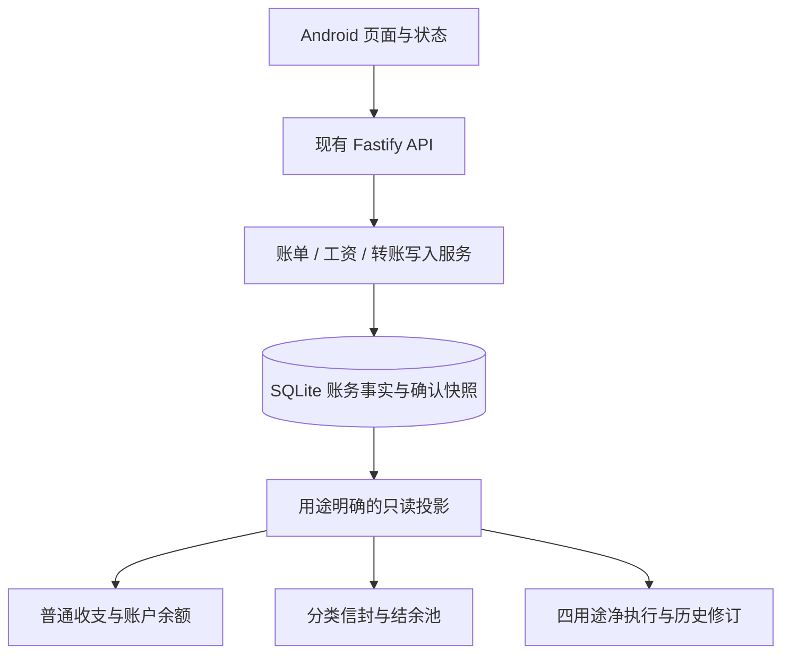

# 项目精简设计：移除废弃 Web，保留 Android 功能与账务口径

日期：2026-10-28。证据范围：当前工作区源码、配置与测试内容；本次没有运行业务测试、构建 APK、访问生产服务或修改账务数据。

## 1. 用户已确认的范围

- Web 已废弃、不再使用，可以删除。
- 保留现有 Android 功能，精简内部实现。
- 本次交付详细计划和记账主要逻辑的复杂度判断。
- 不创建 Trellis 任务；本次只新增规划文档，不执行业务代码重构或 Web 删除。

## 2. 设计结论

普通记账的金额规则比较简单；工资分配与信封预算有必要的中等复杂度。主要维护压力来自新增理财执行、退款分摊、AI 导入与客户端状态处理，以及旧 Web 工具链的残留。

采用逐批重构：先去掉废弃平台，再统一重复的数据转换和计算准备，最后拆分职责过多的服务与页面。保留 Fastify + SQLite + TypeScript shared + Kotlin/Compose 的现有结构。

### 源码依据

| 范围 | 当前实现 | 判断 |
|---|---|---|
| 收入、支出 | `packages/shared/src/types.ts` 的 `expenseContribution`、`incomeContribution` | 两个简单金额贡献函数，继续作为普通收支的统一规则入口 |
| 账户余额、转账 | `packages/shared/src/account-balance.ts` | 初始余额 + 普通收入 + 工资 - 支出 + 转入 - 转出；转账独立于收支，结构合理 |
| 工资与分类预算 | `packages/server/src/services/salary-service.ts` | 工资与分配快照原子写入；分配合计等于工资；保留独立工资事实与分配快照 |
| 信封预算、结余池 | `packages/shared/src/budget-engine.ts` | 周期分组、历史窗口和结余池计算存在重复准备/遍历，可共享准备结果 |
| 预算读取 | `budget-overview-service.ts`、`stats-service.ts` | 存在相近的账单/分配读取与行转换；适合统一必要的数据投影 |
| 四用途执行 | `financial-planning-service.ts` 3186 行、`financial-execution.ts` 1583 行 | 配置、分类映射、工资来源、周期快照、退款分摊、执行读取集中；按职责拆分 |
| Android | `AssistantTab.kt` 2546 行、`FinancialExecutionModels.kt` 1835 行 | UI、请求生命周期和手工 JSON 解码集中；分离状态与解析，保留现有网络边界校验 |
| 废弃 Web | `packages/web/src` 18454 行，另有工具、测试和资源 | 可以删除；实际删除规模大于这个仅源码统计值 |

物理行数包含注释，不包含测试或构建产物。行数用于定位维护热点，不作为单独的删除依据。

## 3. 必须保持的账务规则

### 3.1 普通账本与现金流

- 金额使用整数分，服务端边界保留安全整数校验；时间为 epoch 毫秒。
- 普通支出贡献 `+amountCents` 到支出，普通收入贡献 `+amountCents` 到收入。
- 退款是 `type = 1` 的收入记录，使用 `isRefund` 标记；普通收入统计包含退款，普通支出保持毛额。
- 账户余额包含工资入账；工资不能同时作为第二笔普通收入重复计入。
- 同一活跃账户集合内，转账总净影响为零；转账不进入收支、分类预算或普通统计。
- 软删除记录不进入派生结果；删除账户时该账户退出余额表，跨已删除账户的转账仍影响活跃的一侧。
- 账户余额保持现有全量实时事实口径，包括现有未来日期记录的行为；不新增日期过滤或余额缓存。

例：支出 100 元、收到退款 30 元，普通支出是 100 元、收入是 30 元，账户净减少 70 元。

### 3.2 工资、信封预算与结余池

- 工资与分配快照在同一数据库事务内写入，分配合计必须等于工资金额。
- 自然月内多次工资分配合并；该模式的周期起点为同月最早工资日。
- 自然月最新周期保持当前无上界窗口行为；历史周期截止到下一个更新周期的起点。
- 自定义起始日保持现有 1–28 日范围、工资归属月和 `[start, end)` 窗口语义。
- “当前周期”保持最新有分配的周期，不改成今天所在月份。
- 未配置预算的实际支出分类仍以零预算模块参与计算，不能漏掉消费。
- 信封预算的支出采用毛额；退款收入不回补分类信封额度。
- 历史剩余进入结余池；当前周期剩余尚不进入池；当前超支借用扣减池；池可以为负。
- 未知历史周期保持路由拒绝，不回退到当前周期。
- 历史池值与趋势序列、当前池值与当前超支处理保持现有契约。

### 3.3 四用途执行与测算

- 四用途执行继续基于真实工资、确认的周期/修订、冻结配置与用途映射计算。
- 四用途退款按确认的分摊回溯原支出，得到用途净消费；不是再次写入普通账本。
- 同一笔退款的分摊合计与原单剩余可退额度保留现有校验。
- 原单或退款的金额、类型、删除/恢复/清除变化保持整集失效与审计；恢复账单不自动恢复旧分摊。
- 现有 `operationId` 重放、来源 token、修订比较与原子提交保留；工资重放先于重新解析已变化的模板。
- 各周期保存的时区与冻结窗口继续生效，不改成统一使用当前服务器时区。
- 独立测算继续不写账单、工资、账户或执行周期。
- 成长/应急未接入实际划拨的现状与展示保持；结构重构不增加自动转账或投资行为。

例：同一笔 100 元支出，在确认归属与 30 元退款分摊后，四用途净消费是 70 元。普通现金流与用途净消费是两个明确的业务视图。

## 4. 删除 Web 的边界

### 删除与清理

- 删除 `packages/web/`，包括 Vue/PWA、页面、资源、构建检查、浏览器 E2E、参考宿主。
- 删除根 `package.json` 的 `build:web-reference`、`test:web-reference`、`test:web-reference:only`、`test:iphone`、`test:iphone:only`。
- 在全库用途核对后移除根 `@playwright/test`、`eslint-plugin-vue` 及 Web 专属 ESLint 配置；Vite/Vue/Pinia/PWA 依赖随 Web importer 清除。
- 使用 pnpm 正常更新锁文件，清掉 Web importer 与不可达的专属依赖；继续保留 `onlyBuiltDependencies`。
- 更新根 README、USAGE、clients 文档、有效规范与 Web 指向注释，删除仍要求运行 Web 的当前操作说明。

### 继续保留的能力与证据

- `packages/server/scripts/e2e-*.mjs` 多数是 API 回归，逐文件分类后保留；`e2e-pwa.mjs` 也必须先读实际内容。
- 保留 `check-api-only.mjs`、`lib/retired-web.mjs` 和 JSON 404 回归：它们证明旧 Web 路径没有重新成为页面入口。
- `deploy/test_source_bundle.py` 中的虚构 Web 路径是排除测试输入，允许保留作为负例。
- Web 浏览器测试里独有的 API 断言和测试数据，先迁到 server 测试；浏览器布局/PWA/旧 iPhone 断言随 Web 退役。
- shared 的金额、分类色板、日期、导入等代码继续由实际 server/Android/Harmony 使用情况决定，不因 Web 删除整包移除。
- `.trellis/tasks/`、历史日志与历史行为规格保持追溯用途；有效规范明确 Web 退役，不要求历史记录不存在 `packages/web` 字样。

用户的 Web 删除授权覆盖本轮退役范围，不再把“等待 Android 全量验收才允许删除 Web”的旧规范当作阻塞条件。服务端/设备验收仍用于验证当前功能，不作为再次确认 Web 是否可删的前置条件。

## 5. 重构边界与实现选择

以下是本方案的实现建议，执行者可以调整内部命名，但必须保持指定职责、公开接口和验证结果：

1. **账务服务**：保留 `TransactionService`、`SalaryService`、`TransferService` 的现有外部方法；拆出账单输入/DTO、退款关联与写入辅助，不建立第二个账本或通用规则框架。
2. **只读投影**：只统一已有重复的活跃账单/工资分配读取与行转换；账户、时间窗口、分类范围使用显式参数；保留普通统计与理财快照的不同输入。
3. **信封预算**：共享已排序分配、周期分组、窗口模块和历史池的准备结果；现有四个公开计算函数继续可用，输出顺序和历史语义保持。
4. **理财服务**：保留 `FinancialPlanningService` 作为兼容外观，拆成 types、config/mapping、period/source、refund/execution 四组实现；复用现有 operation、purpose、source-lifecycle 模块。
5. **Android**：按已有 WorkOwner、request ticket、stream reducer 模式拆分屏幕状态；共用语义完全一致的基础 JSON 读法，业务解码继续负责自己的约束。
6. **AI 与导入**：保留对话、单文件/多文件导入、旧账整理的功能；复用已有导入 identity/analysis 模块和账单写入，不强行将不同工作流合成一个状态机。

### 依赖方向

计算继续落在 shared；图中三个结果分支保持各自账务语义。

## 6. 执行顺序与完成标准

1. 建立当前工作区的源码/功能/测试基线。
2. 删除 Web 与工具链，迁移仍有价值的 API 测试。
3. 整理普通账务的重复校验、DTO 和只读投影。
4. 消除信封预算重复准备与历史池计算路径。
5. 拆分四用途服务，保持重放、修订、来源和退款分摊约束。
6. 整理 Android 状态与网络解析，随后拆分 AI/导入协调代码。
7. 完成 Android → API 的真实流程回归及有效文档对齐。

每批独立检查、独立可回退；本轮默认无需数据库迁移。任何字段、账务语义、表结构或用户操作流程变化都需要从结构重构中单独列出，重新明确范围。

完成标准：当前构建与操作文档不依赖 Web；现有 Android 入口、字段与功能保留；相同输入的普通收支、余额、预算、结余池和四用途输出保持；重复提交与来源变化保持正确；当前有效文档能说明三个计算视图。源码、本地测试、设备和生产部署证据分别记录。

现有 E2E 使用 `resetToKnownState`，验收执行在隔离测试服务与合成账本上。生产账本不作为重构测试库。
